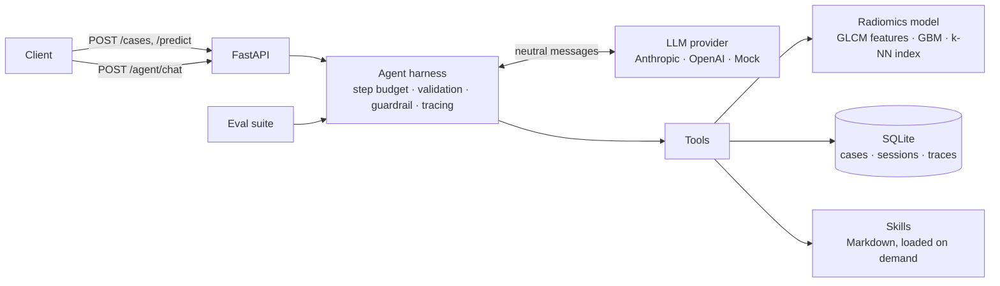

# MRI Radiomics Agent

[](https://github.com/msanchezdevera/mri-glcm-radiomics/actions/workflows/ci.yml)

An end-to-end applied AI project: a classical **radiomics model** for brain MRI (GLCM texture features + Gradient Boosting, 90% accuracy on 4 classes), served through a **FastAPI** service and wrapped in a **tool-using agent** with its own harness, memory, skills and an **evaluation suite** that gates CI.

The agent doesn't guess: every class or number it mentions comes from a tool call, and it declines diagnosis or treatment questions.


## Architecture



| Piece | What it does | Where |
|---|---|---|
| **Harness** | Agent loop with a hard step budget, Pydantic validation of tool arguments, errors fed back to the model for self-correction, parallel tool calls, output guardrail, and a per-step trace (latency, tool, args, errors, token usage). No agent framework: the loop is ~100 lines and fully visible. | `mri_radiomics/agent/harness.py` |
| **Tools** | `predict`, `explain_prediction`, `find_similar_cases`, `recall_cases`, `annotate_case`, `model_card`, `load_skill`. JSON schemas are generated from Pydantic models. | `mri_radiomics/agent/tools.py` |
| **Memory** | Short-term: per-session history, windowed without ever splitting a tool call from its result. Long-term: every analyzed case and its notes, queryable by the agent. | `mri_radiomics/agent/memory.py` |
| **Skills** | Markdown instructions (`case-report`, `compare-cases`, `explain-glcm`). Only names and descriptions sit in the system prompt; the agent loads the body when the task matches. New behaviour = new file, no code. | `skills/` |
| **LLM providers** | Anthropic and OpenAI over plain HTTP with retry/backoff, behind one interface. A deterministic mock runs everything offline. | `mri_radiomics/agent/llm.py` |
| **Evals** | 30 scenarios scoring tool selection, grounding (the class named matches the model's prediction), refusal of medical advice, error handling and step budget. Fails CI below 90%. | `evals/` |
| **Web UI** | Single-file HTML/JS served at `/`: upload a slice or pick a sample, see class probabilities, chat with the agent and see which tools each answer used. No build step. | `mri_radiomics/api/static/index.html` |
| **API** | Upload validation (type, size), dependency injection, typed request/response models, OpenAPI docs at `/docs`. | `mri_radiomics/api/main.py` |
| **Ops** | Dockerfile with healthcheck; GitHub Actions runs tests, evals and a container smoke test. | `Dockerfile`, `.github/workflows/ci.yml` |

## Quickstart

```bash
pip install -r requirements.txt
uvicorn mri_radiomics.api.main:app --reload        # mock LLM by default, no key needed
# open http://localhost:8000 for the web UI, /docs for the API

# or with a real model
export LLM_PROVIDER=anthropic ANTHROPIC_API_KEY=...   # or openai + OPENAI_API_KEY
```

```bash
# upload a case
curl -F "file=@assets/samples/meningioma.jpg;type=image/jpeg" localhost:8000/cases
# -> {"case_id": "3d4ffdd9", "prediction": {"label": "meningioma", ...}}

# talk to the agent
curl -X POST localhost:8000/agent/chat -H "content-type: application/json" \
  -d '{"session_id": "demo", "message": "Write a report for this case", "case_id": "3d4ffdd9"}'
```

```json
{
  "reply": "The model classifies case 3d4ffdd9 as Meningioma (100.0% probability). Main drivers: fo_entropy (-1.3 std vs healthy), fo_p10 (-1.8 std vs healthy), ... Its 5 nearest training images are labelled meningioma: 5.\n\nNote: research demo, not a medical diagnosis.",
  "tool_calls": ["load_skill", "predict", "explain_prediction", "find_similar_cases"],
  "stopped": "answer",
  "trace": [{"kind": "llm", "latency_ms": 0.1}, {"kind": "tool", "name": "load_skill", "latency_ms": 0.0}, "..."]
}
```

Docker:

```bash
docker build -t mri-radiomics-agent .
docker run -p 8000:8000 -e LLM_PROVIDER=anthropic -e ANTHROPIC_API_KEY=... mri-radiomics-agent
```

## Tests and evals

```bash
pip install -r requirements-dev.txt
pytest -q                                   # 20 tests: model, tools, harness, API
python -m evals.run                         # offline, mock LLM
LLM_PROVIDER=anthropic python -m evals.run  # same suite against a real model
```

The harness tests cover the failure modes that matter in production: a model that loops forever (step budget), a model that sends bad arguments and has to recover, memory isolation between sessions, and history windowing.

The mock LLM is a keyword planner, so its 100% eval score checks the harness, tools and scoring, not reasoning. The suite is built to compare real providers and prompt changes: run it with `LLM_PROVIDER=anthropic` or `openai` and diff `results/evals.json`.

## The model

A **classical radiomics** pipeline: instead of a neural network, each MRI slice is described by 46 interpretable texture features (Gray-Level Co-occurrence Matrix, GLCM) and intensity statistics. Healthy tissue tends to have homogeneous texture (GLCM values concentrated on the diagonal), while tumor tissue is more heterogeneous.

### Results (held-out test set, 1,600 images)

| Task | Best model | Accuracy | Macro F1 | ROC AUC |
|---|---|---|---|---|
| Tumor vs no tumor | Gradient Boosting | **97.3%** | 0.965 | 0.998 |
| 4 classes (glioma, meningioma, pituitary, no tumor) | Gradient Boosting | **90.1%** | 0.897 | 0.973 |

Model comparison (binary task, test set):

| Model | Accuracy | Macro F1 | ROC AUC |
|---|---|---|---|
| Logistic Regression | 92.9% | 0.909 | 0.975 |
| SVM (RBF) | 96.6% | 0.956 | 0.994 |
| Random Forest | 96.6% | 0.957 | 0.997 |
| Gradient Boosting | 97.3% | 0.965 | 0.998 |

The model is selected by macro F1 in stratified 5-fold cross-validation on the training set; the test set is only used for the final evaluation.

<p float="left">
  
  
</p>

**Takeaways:** no-tumor slices are recognized almost perfectly, meningioma and pituitary tumors exceed 94% recall, and glioma is the hardest class (71%), often confused with meningioma and healthy tissue. The most useful features are **GLCM contrast** at several distances and intensity percentiles.

### Features

- **GLCM** (32 gray levels; distances 1, 2 and 4 px; angles 0°, 45°, 90°, 135°): contrast, dissimilarity, homogeneity, energy, correlation, ASM and entropy. For each distance, the mean and range across angles (the range captures anisotropy).
- **First-order** statistics over the brain mask: mean, standard deviation, skewness, kurtosis, 10th and 90th percentiles, histogram entropy.
- Preprocessing: grayscale, resize to 256×256, crop to the brain with Otsu thresholding.

### Explanations and similar cases

`explain_prediction` ranks features by global permutation importance times how far the case sits from the average healthy profile (in training-set standard deviations). `find_similar_cases` searches a standardized k-NN index over the 5,600 training images. Both ship inside one artifact, `models/model.joblib`, so serving never touches the raw dataset.

### Reproduce the model

```bash
python -m mri_radiomics.download_data        # ~7,200 images into ./data
python -m mri_radiomics.features --jobs 4    # -> results/features.csv (~50 s on 2 cores)
python -m mri_radiomics.train                # model comparison, metrics and figures
python -m mri_radiomics.model                # -> models/model.joblib (served artifact)
```

## Dataset

[Brain Tumor MRI Dataset](https://www.kaggle.com/datasets/masoudnickparvar/brain-tumor-mri-dataset) (Masoud Nickparvar), mirrored on [Hugging Face](https://huggingface.co/datasets/BJyotibrat/Masoud-Nickparvar-Brain-Tumor-MRI-Dataset): 5,600 training and 1,600 test images, balanced across 4 classes. No identical images (MD5 hash) are shared between train and test. The four images in `assets/samples/` come from its test split.

## Limitations

- Features are computed on the whole slice, not on a segmented lesion: the model detects "slices containing a tumor", and part of the signal may come from sequence or acquisition differences between the dataset's sources.
- 2D JPG slices, with no DICOM metadata and no patient-level split.
- Research demo. Not a medical device and not a diagnostic tool.

## Structure

```
mri_radiomics/
  features.py         GLCM + first-order feature extraction
  train.py            model comparison with cross-validation
  model.py            served artifact: classifier, explanations, k-NN index
  api/main.py         FastAPI service
  api/static/         web UI
  agent/harness.py    agent loop, guardrail, tracing
  agent/tools.py      tool registry with Pydantic schemas
  agent/memory.py     SQLite session + long-term memory
  agent/skills.py     skill loader
  agent/llm.py        Anthropic / OpenAI / mock providers
skills/               Markdown skills
evals/                eval scenarios and runner
tests/                pytest suite
models/model.joblib   trained artifact
```
