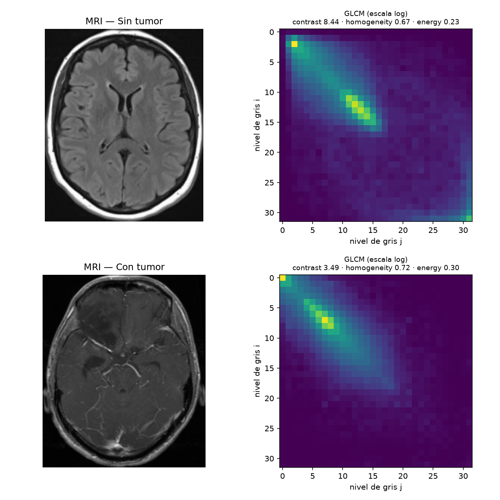
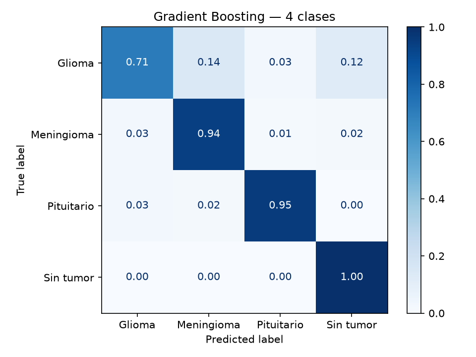
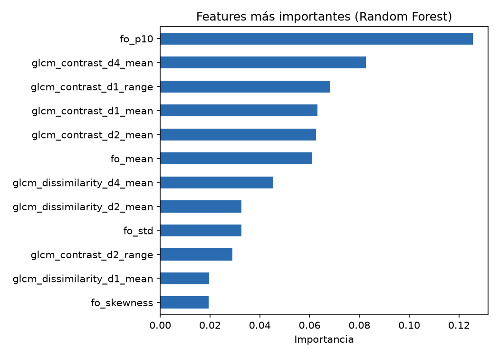

# Detección de tumores cerebrales en MRI con features de textura (GLCM)

Pipeline de **radiómica clásica**: en lugar de una red neuronal, cada resonancia se describe con 46 características interpretables de textura (matriz de co-ocurrencia de niveles de gris, GLCM) y de intensidad, y se clasifica con modelos de machine learning tradicionales.

Parte de un trabajo de **Ingeniería de Características** (Universidad de Palermo), donde analizamos cómo la GLCM distingue tejido sano (textura homogénea, valores concentrados en la diagonal) de tejido tumoral (textura heterogénea, valores dispersos). Este repo lleva esa idea a un dataset real de 7.200 MRI.



## Resultados (test set, 1.600 imágenes)

| Tarea | Mejor modelo | Accuracy | F1 macro | ROC AUC |
|---|---|---|---|---|
| Tumor vs sin tumor | Gradient Boosting | **97.3%** | 0.965 | 0.998 |
| 4 clases (glioma, meningioma, pituitario, sin tumor) | Gradient Boosting | **90.1%** | 0.897 | 0.973 |

Comparación de modelos (tarea binaria, test):

| Modelo | Accuracy | F1 macro | ROC AUC |
|---|---|---|---|
| Regresión logística | 92.9% | 0.909 | 0.975 |
| SVM (RBF) | 96.6% | 0.956 | 0.994 |
| Random Forest | 96.6% | 0.957 | 0.997 |
| Gradient Boosting | 97.3% | 0.965 | 0.998 |

El modelo se elige por F1 macro en validación cruzada estratificada de 5 folds sobre el set de entrenamiento; el test set no se toca hasta la evaluación final.

<p float="left">
  
  
</p>

**Lectura:** las imágenes sin tumor se reconocen casi perfecto, meningioma y pituitario superan el 94%, y el glioma es la clase más difícil (71%), que se confunde con meningioma y con tejido sano. Las features más útiles son el **contraste GLCM** a distintas distancias y percentiles de intensidad.

## Features

- **GLCM** (32 niveles de gris; distancias 1, 2 y 4 px; ángulos 0°, 45°, 90°, 135°): contraste, disimilitud, homogeneidad, energía, correlación, ASM y entropía. Para cada distancia, media y rango entre ángulos (el rango mide anisotropía).
- **Primer orden** sobre la máscara del cerebro: media, desvío, asimetría, curtosis, percentiles 10 y 90, entropía del histograma.
- Preprocesamiento: escala de grises, resize a 256×256, recorte al cerebro con umbral de Otsu.

## Uso

```bash
pip install -r requirements.txt
python src/download_data.py                 # ~7.200 imágenes a ./data
python src/features.py --jobs 4             # -> results/features.csv
python src/train.py                         # -> results/metrics.json + figuras
python src/visualize_glcm.py data/Testing/notumor/Te-no_100.jpg data/Testing/glioma/Te-gl_100.jpg
```

Extracción de features de las 7.200 imágenes: ~50 s en 2 núcleos. Entrenamiento y evaluación: unos minutos en CPU.

## Dataset

[Brain Tumor MRI Dataset](https://www.kaggle.com/datasets/masoudnickparvar/brain-tumor-mri-dataset) (Masoud Nickparvar), versión espejada en [Hugging Face](https://huggingface.co/datasets/BJyotibrat/Masoud-Nickparvar-Brain-Tumor-MRI-Dataset): 5.600 imágenes de entrenamiento y 1.600 de test, balanceadas en 4 clases. Verifiqué que no hay imágenes idénticas (hash MD5) entre train y test.

## Limitaciones

- Las features se calculan sobre el corte completo, no sobre la lesión segmentada: el modelo detecta "cortes con tumor", y parte de la señal puede venir de diferencias de secuencia o adquisición entre fuentes del dataset.
- Cortes 2D en JPG, sin metadatos DICOM ni separación por paciente.
- Proyecto académico. No es una herramienta de diagnóstico.

## Estructura

```
src/
  download_data.py   descarga del dataset
  features.py        extracción GLCM + primer orden
  train.py           validación cruzada, evaluación y figuras
  visualize_glcm.py  comparación visual de GLCM
results/             features.csv, metrics.json y figuras
assets/              imágenes del README
```
